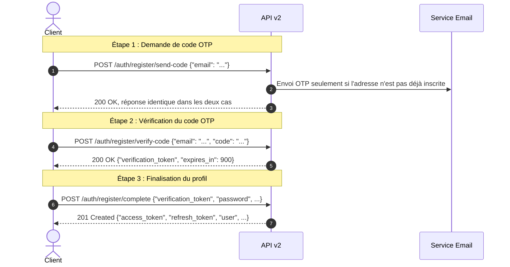
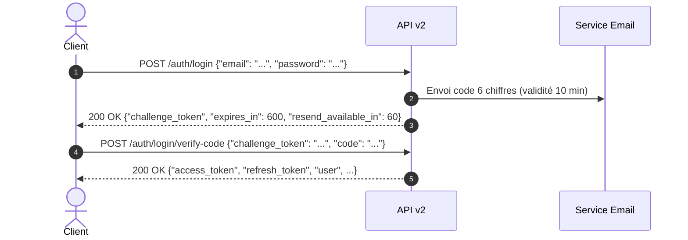
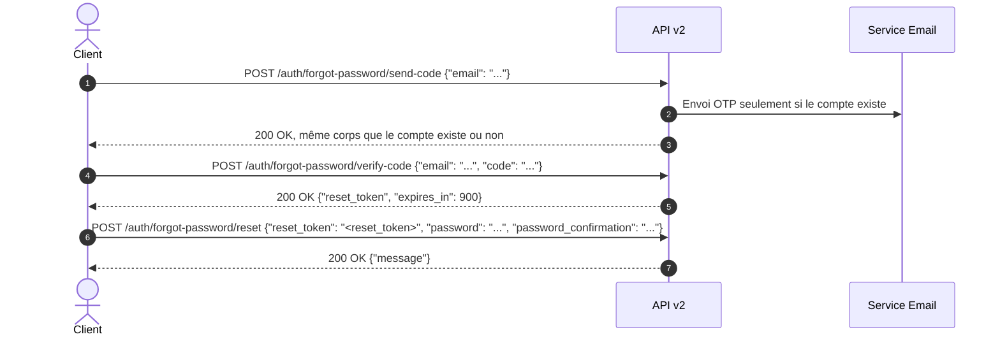

# Guide d'Intégration de l'API v2 (Front Web & Mobile)

> **Version de l'API :** `v2`  
> **Dernière mise à jour :** 2026-10-10  
> **Destinataires :** Développeurs Front-end (Web React/Vue/Angular), Mobile (React Native/Flutter/iOS/Android), QA & Testeurs d'API.  
> **Comment utiliser ce guide :**  
> - **Intégration rapide :** Lisez les sections 1, 2, 3 et 5 pour appréhender les concepts clés, le flux de langue/pays et la gestion des tokens.  
> - **Référence des endpoints :** Consultez les sections 4, 6 et 7 pour les signatures exactes des 25 endpoints de l'API.  
> - **Recette & Tests manuels :** Utilisez la section 10 pour configurer Insomnia ou Postman avec chaînage automatique et exécuter la checklist de validation.
> - **Référence complète :** Consultez la [spécification OpenAPI v2](../openapi.yaml) pour les schémas, les codes d'erreur et les réponses détaillées.

---

## Sommaire

- [0. En-tête](#guide-dintégration-de-lapi-v2-front-web--mobile)
- [1. Démarrage rapide (5 minutes)](#1-démarrage-rapide-5-minutes)
- [2. Concepts à connaître](#2-concepts-à-connaître)
  - [2.1 Headers de requête et de réponse](#21-headers-de-requête-et-de-réponse)
  - [2.2 Les 5 jetons de l'API](#22-les-5-jetons-de-lapi)
  - [2.3 Format standardisé des erreurs](#23-format-standardisé-des-erreurs)
  - [2.4 Formats de dates, identifiants et durées](#24-formats-de-dates-identifiants-et-durées)
- [3. Langue et pays](#3-langue-et-pays)
  - [3.1 Principe directeur](#31-principe-directeur)
  - [3.2 La règle d'or pour le front](#32-la-règle-dor-pour-le-front)
  - [3.3 Priorité de résolution de la langue](#33-priorité-de-résolution-de-la-langue)
  - [3.4 Résolution du pays et sélection obligatoire](#34-résolution-du-pays-et-sélection-obligatoire)
  - [3.5 Référence des endpoints de locale](#35-référence-des-endpoints-de-locale)
  - [3.6 Ce que la langue change réellement](#36-ce-que-la-langue-change-réellement)
  - [3.7 Exemple d'intégration client (TypeScript)](#37-exemple-dintégration-client-typescript)
  - [3.8 Pièges courants](#38-pièges-courants)
- [4. Flux d'authentification](#4-flux-dauthentification)
  - [4.1 Inscription en 3 étapes (OTP)](#41-inscription-en-3-étapes-otp)
  - [4.2 Connexion avec 2FA obligatoire (OTP)](#42-connexion-avec-2fa-obligatoire-otp)
  - [4.3 Mot de passe oublié (OTP)](#43-mot-de-passe-oublié-otp)
  - [4.4 Renvoi de code OTP](#44-renvoi-de-code-otp)
  - [4.5 Rafraîchissement des jetons](#45-rafraîchissement-des-jetons)
- [5. Gestion des tokens côté client](#5-gestion-des-tokens-côté-client)
  - [5.1 Où stocker les jetons](#51-où-stocker-les-jetons)
  - [5.2 Quand rafraîchir le jeton](#52-quand-rafraîchir-le-jeton)
  - [5.3 Piège de la rotation et file d'attente single-flight](#53-piège-de-la-rotation-et-file-dattente-single-flight)
  - [5.4 Gestion de l'échec de rafraîchissement (422)](#54-gestion-de-léchec-de-rafraîchissement-422)
- [6. Profil, mot de passe, email, appareils et déconnexion](#6-profil-mot-de-passe-email-appareils-et-déconnexion)
  - [6.1 Consultation du profil](#61-consultation-du-profil)
  - [6.2 Modification du profil et changement d'email](#62-modification-du-profil-et-changement-demail)
  - [6.3 Confirmation du nouvel email (connecté vs invité)](#63-confirmation-du-nouvel-email-connecté-vs-invité)
  - [6.4 Changement de mot de passe](#64-changement-de-mot-de-passe)
  - [6.5 Gestion des sessions et appareils connectés](#65-gestion-des-sessions-et-appareils-connectés)
  - [6.6 Déconnexion de la session courante](#66-déconnexion-de-la-session-courante)
  - [6.7 Suppression définitive du compte](#67-suppression-définitive-du-compte)
- [7. Référence des endpoints](#7-référence-des-endpoints)
- [8. Limites de débit](#8-limites-de-débit)
- [9. Catalogue des erreurs](#9-catalogue-des-erreurs)
- [10. Procédure de tests manuels (Insomnia / Postman)](#10-procédure-de-tests-manuels-insomnia--postman)
  - [10.1 Environnement et variables](#101-environnement-et-variables)
  - [10.2 Enchaînement automatique des jetons](#102-enchaînement-automatique-des-jetons)
  - [10.3 Consultation des codes OTP en local](#103-consultation-des-codes-otp-en-local)
  - [10.4 Parcours de validation ordonné](#104-parcours-de-validation-ordonné)
  - [10.5 Checklist de validation finale](#105-checklist-de-validation-finale)
  - [10.6 Réinitialisation de la base de données](#106-réinitialisation-de-la-base-de-données)
- [11. Annexe : Changements par rapport à la version antérieure](#11-annexe--changements-par-rapport-à-la-version-antérieure)

---

## 1. Démarrage rapide (5 minutes)

Voici le parcours minimal pour configurer votre client et exécuter un premier appel authentifié :

1. **Obtenez le contexte de langue et pays initial** :
   ```bash
   curl -s -X GET "http://127.0.0.1:8000/api/v2/locale" \
     -H "Accept: application/json"
   ```
   Stockez la valeur de `language.code` (ex: `fr`) reçue dans la réponse.

2. **Initiez la connexion (Étape 1 : vérification des identifiants et envoi du code 2FA)** :
   ```bash
   curl -s -X POST "http://127.0.0.1:8000/api/v2/auth/login" \
     -H "Accept: application/json" \
     -H "Content-Type: application/json" \
     -H "X-Locale-Override: fr" \
     -d '{"email":"david@example.com","password":"Password123!"}'
   ```
   Conservez le `challenge_token` retourné.

3. **Récupérez le code OTP** dans vos logs applicatifs (`storage/logs/laravel.log`) ou dans la table `verification_codes`.

4. **Validez le code 2FA (Étape 2 : émission des jetons d'accès)** :
   ```bash
   curl -s -X POST "http://127.0.0.1:8000/api/v2/auth/login/verify-code" \
     -H "Accept: application/json" \
     -H "Content-Type: application/json" \
     -H "X-Locale-Override: fr" \
     -d '{"challenge_token":"<challenge_token>","code":"123456","device_name":"Mon Client Mobile"}'
   ```
   Stockez `access_token` et `refresh_token`.

5. **Appelez un endpoint sécurisé avec le Bearer token** :
   ```bash
   curl -s -X GET "http://127.0.0.1:8000/api/v2/auth/me" \
     -H "Accept: application/json" \
     -H "Authorization: Bearer <access_token>" \
     -H "X-Locale-Override: fr"
   ```

---

## 2. Concepts à connaître

### 2.1 Headers de requête et de réponse

| Header | Sens | Présence | Description |
|---|---|---|---|
| `Accept: application/json` | Requête | **Obligatoire** | Empêche Laravel de renvoyer des redirections HTML en cas d'erreur ou d'échec d'authentification. L'API répondra toujours en JSON. |
| `Content-Type: application/json` | Requête | Requis pour POST, PUT, PATCH | Indique que le corps de la requête est formaté en JSON. |
| `Authorization: Bearer <token>` | Requête | Requis sur routes protégées | Transmet l'access token Sanctum de la session en cours. |
| `X-Locale-Override: <code>` | Requête | Recommandé systématiquement | Force la langue désirée (ex: `fr`, `en`, `ar`) sans altérer le profil de l'utilisateur. |
| `Accept-Language: <tags>` | Requête | Optionnel | Langues acceptées par le navigateur (priorité inférieure à `X-Locale-Override`). |
| `Content-Language` | Réponse | Toujours présent | Indique la langue exacte appliquée par le serveur pour générer la réponse. |
| `Retry-After` | Réponse | Présent sur HTTP 429 | Nombre entier de secondes avant de pouvoir retenter la requête. |
| `Vary` | Réponse | Toujours présent | Vaut `Accept-Language, X-Locale-Override, Authorization` pour guider les caches HTTP. |

---

### 2.2 Les 5 jetons de l'API

L'API manipule 5 jetons distincts, chacun dédié à un usage précis :

| Jeton | Obtenu à l'endpoint | Transmis à l'endpoint | Durée de vie réelle | Stockage recommandé |
|---|---|---|---|---|
| `verification_token` | `POST /register/verify-code` | `POST /register/complete` | 15 minutes (`900 s`) | Mémoire volatile (écran d'inscription) |
| `challenge_token` | `POST /login` ou `POST /login/resend-code` | `POST /login/verify-code` | 15 minutes (`900 s`) | Mémoire volatile (écran de saisie 2FA) |
| `reset_token` | `POST /forgot-password/verify-code` | `POST /forgot-password/reset` | 15 minutes (`900 s`) | Mémoire volatile (écran nouveau mot de passe) |
| `access_token` | `login/verify-code`, `register/complete`, `refresh` | Toutes requêtes protégées (`Bearer`) | 1440 minutes (`86400 s`, soit 24 h) | Keychain / Keystore / Mémoire d'application |
| `refresh_token` | `login/verify-code`, `register/complete`, `refresh` | `POST /auth/refresh` | 30 jours (`2592000 s`) | Keychain / Keystore sécurisé (mobile) ou HttpOnly |

> [!CAUTION]
> **Ne pas confondre les jetons !**  
> - Les jetons temporaires (`verification_token`, `challenge_token`, `reset_token`) ont une validité éphémère de 15 minutes et sont consommés immédiatement après usage unique. Ils ne peuvent en aucun cas servir de jeton d'authentification Bearer.  
> - L'`access_token` est le seul jeton utilisable dans l'en-tête `Authorization: Bearer <token>`.  
> - Le `refresh_token` est exclusivement destiné au corps de `POST /api/v2/auth/refresh`.

---

### 2.3 Format standardisé des erreurs

Toute réponse d'erreur HTTP 4xx retourne un objet JSON structuré avec un identifiant machine stable dans le champ `code` :

```json
{
  "code": "credentials_invalid",
  "message": "These credentials do not match our records."
}
```

Pour les erreurs de validation HTTP 422 :
```json
{
  "code": "validation_failed",
  "message": "The email field is required.",
  "errors": {
    "email": [
      "The email field is required."
    ]
  }
}
```

> [!IMPORTANT]
> **Règle absolue pour les clients :**  
> Le front-end doit brancher sa logique applicative et ses traductions locales **uniquement sur le champ `code`** (ex: `otp_invalid`, `refresh_token_expired`), et **jamais sur le texte du champ `message`**, qui reste informatif et susceptible d'évoluer.

---

### 2.4 Formats de dates, identifiants et durées

- **Dates et horodatages :** Format standard ISO 8601 UTC avec millisecondes (ex: `2026-10-09T23:49:56.000000Z`).
- **Durées de validité :** Les champs `expires_in`, `refresh_expires_in` et `resend_available_in` sont exprimés en **secondes entières** (ex: `86400` pour 24 heures, `600` pour 10 minutes).
- **Identifiants de sessions / appareils :** Les identifiants retournés par `GET /api/v2/auth/devices` sont des UUIDs stables représentant la famille du jeton (`family_id`, ex: `36a237e6-0023-44f4-8e78-b852be2b4594`).

---

## 3. Langue et pays

### 3.1 Principe directeur

> « Le serveur back-end indique toujours explicitement quelle langue et quel pays il applique ; le client front-end ne doit rien deviner. »

---

### 3.2 La règle d'or pour le front

| Moment du cycle de vie | Action requise du client front |
|---|---|
| **Démarrage de l'application** | Appeler `GET /api/v2/locale`. Stocker localement `language.code` et `country`. Si `country_selection_required: true`, inviter l'utilisateur à choisir un pays parmi la liste `countries`. |
| **Toutes les requêtes suivantes** | Transmettre systématiquement l'en-tête `X-Locale-Override: <code_stocké>`. |
| **L'utilisateur change de langue** | Mettre à jour la valeur dans le stockage local du front. Si l'utilisateur est authentifié, synchroniser son profil via `PATCH /api/v2/locale`. |
| **Après Connexion ou Déconnexion** | Rappeler `GET /api/v2/locale` pour actualiser le contexte et réaligner la langue et le pays. |

**Pourquoi envoyer systématiquement `X-Locale-Override` ?**  
L'en-tête `X-Locale-Override` garantit un comportement déterministe et identique pour les utilisateurs anonymes et authentifiés. Il prend la priorité la plus haute et n'écrit jamais en base de données.

---

### 3.3 Priorité de résolution de la langue

La langue appliquée par l'API est résolue selon l'ordre strict suivant. Si une étape est absente, non prise en charge ou invalide, le résolveur passe silencieusement à l'étape suivante :

| Priorité | Source résolue (`source`) | Mécanisme |
|---|---|---|
| **1 (Max)** | `override` | Valeur reçue dans le header `X-Locale-Override` correspondant à une langue active. |
| **2** | `profile` | Préférence enregistrée dans le profil de l'utilisateur connecté (`user.language_id`). |
| **3** | `accept_language` | Première langue correspondante dans le header `Accept-Language`. |
| **4** | `country` | Langue officielle associée au pays résolu. |
| **5 (Min)** | `default` | Langue par défaut configurée dans l'application (`config('app.locale')`, soit `fr`). |

---

### 3.4 Résolution du pays et sélection obligatoire

L'API **n'effectue aucune géolocalisation par adresse IP** et n'accepte aucun header de pays non sollicité.

Le pays est résolu selon les règles suivantes :
1. **Profil utilisateur :** Si l'utilisateur est connecté et possède un `country_id`, ce pays est appliqué (`source: "profile"`).
2. **Pays unique actif :** S'il n'existe qu'un seul pays actif en base (ex: Burkina Faso), ce pays est appliqué automatiquement (`source: "single_active"`).
3. **Sélection requise :** S'il existe plusieurs pays actifs et que l'utilisateur n'en a pas configuré, le pays vaut `null` (aucun objet, donc aucune propriété `source`) et le champ `country_selection_required` vaut `true`.

`country_selection_required` vaut `true` quand **au moins un pays est actif** et qu'**aucun pays actif n'est résolu** (aucun choix, ou pays du profil devenu inactif).

| Situation | `country` retourné | `source` | `country_selection_required` | Action front |
|---|---|---|---|---|
| Utilisateur connecté avec pays renseigné | Objet Pays | `profile` | `false` | Rien, profil appliqué |
| Utilisateur anonyme, 1 seul pays actif en base | Objet Pays | `single_active` | `false` | Rien, pays unique auto |
| Utilisateur anonyme, plusieurs pays actifs | `null` | — | `true` | Afficher le modal de sélection |
| Utilisateur connecté sans pays, >1 pays actif | `null` | — | `true` | Afficher le modal de sélection |
| Pays de l'utilisateur désactivé | `null` | — | `true` | Demander une nouvelle sélection |

> La propriété `source` n'existe que sur un objet pays résolu. Valeurs possibles : `profile` ou `single_active`. Il n'existe **pas** de valeur `none` : quand rien n'est résolu, `country` est `null`.

---

### 3.5 Référence des endpoints de locale

#### `GET /api/v2/locale`

**Rôle :** Retourne le contexte linguistique et géographique actuel, les préférences de l'utilisateur et les listes disponibles.  
**Auth :** Publique (optionnellement authentifiée) · **Limite :** `auth-api` (60/min)

**Requête**
```http
GET /api/v2/locale HTTP/1.1
Host: 127.0.0.1:8000
Accept: application/json
X-Locale-Override: en
```

*Aucun corps de requête.*

**Succès — `200 OK`**
```json
{
  "language": {
    "id": 2,
    "code": "en",
    "name": "English",
    "source": "override"
  },
  "country": {
    "id": 1,
    "code": "BF",
    "name": "Burkina Faso",
    "native_name": "Burkina Faso",
    "phone_code": "+226",
    "is_active": true,
    "source": "single_active",
    "language": {
      "id": 1,
      "code": "fr",
      "name": "French"
    }
  },
  "country_selection_required": false,
  "preferences": {
    "language_id": null,
    "country_id": null
  },
  "supported_languages": [
    {
      "id": 1,
      "code": "fr",
      "name": "French"
    },
    {
      "id": 2,
      "code": "en",
      "name": "English"
    },
    {
      "id": 3,
      "code": "ar",
      "name": "Arabic"
    }
  ],
  "countries": [
    {
      "id": 1,
      "code": "BF",
      "name": "Burkina Faso",
      "native_name": "Burkina Faso",
      "phone_code": "+226",
      "language": {
        "id": 1,
        "code": "fr",
        "name": "French"
      }
    }
  ]
}
```

---

#### `PATCH /api/v2/locale`

**Rôle :** Met à jour les préférences de langue et/ou de pays enregistrées dans le profil de l'utilisateur.  
**Auth :** Bearer requis · **Limite :** `auth-api` (60/min)

**Requête**
```http
PATCH /api/v2/locale HTTP/1.1
Host: 127.0.0.1:8000
Accept: application/json
Content-Type: application/json
Authorization: Bearer 1|abc...
```
```json
{
  "language_id": 1,
  "country_id": 1
}
```

| Champ | Type | Obligatoire | Règles |
|---|---|---|---|
| `language_id` | integer \| null | Optionnel | ID d'une langue **active** existante, ou `null` pour réinitialiser la langue en mode automatique. Une langue inactive est refusée. |
| `country_id` | integer \| null | Optionnel | ID d'un pays **actif** existant, ou `null` pour réinitialiser le pays en mode automatique. Un pays inactif est refusé. |
| `reset_to_auto` | boolean | Optionnel | Si `true`, réinitialise simultanément la langue et le pays à `null` (détection automatique). **Exclusif** : interdit avec `language_id` ou `country_id`. |

> **Au moins une clé est requise** : un corps vide (`{}`) renvoie `422 validation_failed`. `reset_to_auto: false` seul ne suffit pas à modifier quoi que ce soit.

**Succès — `200 OK`**
```json
{
  "message": "Locale preferences updated successfully.",
  "locale": {
    "language": {
      "id": 1,
      "code": "fr",
      "name": "French",
      "source": "profile"
    },
    "country": {
      "id": 1,
      "code": "BF",
      "name": "Burkina Faso",
      "native_name": "Burkina Faso",
      "phone_code": "+226",
      "is_active": true,
      "source": "profile",
      "language": {
        "id": 1,
        "code": "fr",
        "name": "French"
      }
    },
    "country_selection_required": false,
    "preferences": {
      "language_id": 1,
      "country_id": 1
    },
    "supported_languages": [
      {
        "id": 1,
        "code": "fr",
        "name": "French"
      },
      {
        "id": 2,
        "code": "en",
        "name": "English"
      },
      {
        "id": 3,
        "code": "ar",
        "name": "Arabic"
      }
    ],
    "countries": [
      {
        "id": 1,
        "code": "BF",
        "name": "Burkina Faso",
        "native_name": "Burkina Faso",
        "phone_code": "+226",
        "language": {
          "id": 1,
          "code": "fr",
          "name": "French"
        }
      }
    ]
  },
  "user": {
    "id": 1,
    "first_name": "Alice",
    "last_name": "Dupont",
    "full_name": "Alice Dupont",
    "email": "alice@example.com",
    "pending_email": null,
    "email_verified_at": "2026-10-09T23:49:56.000000Z",
    "language_id": 1,
    "country_id": 1,
    "created_at": "2026-10-09T23:49:56.000000Z",
    "updated_at": "2026-10-09T23:49:56.000000Z"
  }
}
```

**Erreurs possibles**
| Statut | `code` | Quand |
|---|---|---|
| `401` | `unauthenticated` | Jeton Bearer manquant ou invalide. |
| `422` | `validation_failed` | Corps vide (au moins une clé requise) ; `reset_to_auto` combiné à `language_id`/`country_id` ; pays inactif/inexistant (`country_not_available`) ; langue invalide (`language_invalid`). |

**Exemples d'erreur `422`**
```json
{ "code": "validation_failed", "message": "At least one locale field is required.", "errors": { "locale": ["At least one locale field is required."] } }
```
```json
{ "code": "validation_failed", "message": "You cannot use reset_to_auto with language_id or country_id.", "errors": { "reset_to_auto": ["You cannot use reset_to_auto with language_id or country_id."] } }
```

---

#### `GET /api/v2/countries/active`

**Rôle :** Liste publique des pays actifs disponibles pour sélection manuelle.  
**Auth :** Publique · **Limite :** Aucune (ou globale)

**Requête**
```http
GET /api/v2/countries/active HTTP/1.1
Host: 127.0.0.1:8000
Accept: application/json
```

**Succès — `200 OK`**
```json
{
  "country_selection_required": false,
  "countries": [
    {
      "id": 1,
      "code": "BF",
      "name": "Burkina Faso",
      "native_name": "Burkina Faso",
      "phone_code": "+226",
      "language": {
        "id": 1,
        "code": "fr",
        "name": "French"
      }
    }
  ]
}
```

---

### 3.6 Ce que la langue change réellement

La langue résolue (`fr` ou `en`) s'applique aux textes produits par l'API et aux emails OTP :

1. **Messages métier :** Les messages d'authentification (`lang/{en,fr}/auth.php`) sont traduits selon la locale appliquée.
2. **Messages de validation :** `lang/fr/validation.php` existe ; les erreurs de validation, notamment celles des champs obligatoires et des formats, sont traduites en français lorsque `fr` est appliqué.
3. **Emails OTP :** Le sujet et le corps utilisent les clés `mail.*` de `lang/{en,fr}/auth.php` et suivent la locale appliquée au moment de l'envoi.
4. **Noms de pays et de langues :** Ils proviennent de la base de données et ne sont pas traduits par l'API.

Les fichiers de langue anglais et français ont les mêmes clés (vérifié par `AuthLocalizationTest`) ; aucune clé de traduction manquante n'est signalée par ce contrôle. Le champ `code` n'est jamais traduit : le client doit baser sa logique sur `code`, et peut traduire les messages avec son propre dictionnaire au lieu d'afficher `message`.

---

### 3.7 Exemple d'intégration client (TypeScript)

```typescript
import axios from 'axios';

// 1. Définition du client HTTP avec intercepteur
export const api = axios.create({
  baseURL: 'http://127.0.0.1:8000/api/v2',
  headers: {
    Accept: 'application/json',
  },
});

// Intercepteur : injection automatique de l'override de langue et du token
api.interceptors.request.use((config) => {
  const currentLocale = localStorage.getItem('app_locale') || 'fr';
  config.headers['X-Locale-Override'] = currentLocale;

  const accessToken = localStorage.getItem('access_token');
  if (accessToken) {
    config.headers.Authorization = `Bearer ${accessToken}`;
  }
  return config;
});

// 2. Initialisation au démarrage de l'application
export async function initAppLocale(): Promise<void> {
  const response = await api.get('/locale');
  const { language, country, country_selection_required } = response.data;

  // Persister la langue résolue localement
  if (language?.code) {
    localStorage.setItem('app_locale', language.code);
  }

  // Déclencher le modal de sélection si requis
  if (country_selection_required) {
    openCountrySelectorModal(response.data.countries);
  }
}

// 3. Changement de langue par l'utilisateur
export async function changeLanguage(languageId: number, languageCode: string, isAuthenticated: boolean): Promise<void> {
  localStorage.setItem('app_locale', languageCode);
  if (isAuthenticated) {
    await api.patch('/locale', { language_id: languageId });
  }
}
```

---

### 3.8 Pièges courants

| Symptôme constaté | Cause réelle | Solution à appliquer |
|---|---|---|
| Le changement du header `Accept-Language` ne modifie pas la réponse. | `X-Locale-Override` ou le profil utilisateur a une priorité plus élevée. | Vérifier et envoyer `X-Locale-Override: <lang>` ou modifier le profil via `PATCH /locale`. |
| Le champ `country` vaut `null`. | Plusieurs pays sont actifs et aucun pays n'est sélectionné. | `country_selection_required` vaut `true` : afficher le sélecteur de pays. |
| Erreur 422 lors du `PATCH /locale`. | Utilisation simultanée de `reset_to_auto: true` avec `language_id` ou `country_id`. | `reset_to_auto` s'utilise seul, sans spécifier d'identifiants. |

---

## 4. Flux d'authentification

### 4.1 Inscription en 3 étapes (OTP)



#### `POST /api/v2/auth/register/send-code`

**Rôle :** Envoie un code OTP à 6 chiffres par email pour débuter l'inscription.  
**Auth :** Publique · **Limite :** `otp-send` (1/min, 5/h)

**Requête**
```http
POST /api/v2/auth/register/send-code HTTP/1.1
Host: 127.0.0.1:8000
Accept: application/json
Content-Type: application/json
```
```json
{
  "email": "newuser@example.com"
}
```

| Champ | Type | Obligatoire | Règles |
|---|---|---|---|
| `email` | string | **Oui** | Format email valide. |

**Succès — `200 OK`**
```json
{
  "message": "A verification code has been sent to your email address.",
  "email": "newuser@example.com",
  "expires_in": 600,
  "resend_available_in": 60
}
```

**Erreurs possibles**
| Statut | `code` | Quand |
|---|---|---|
| `422` | `validation_failed` | Adresse email manquante ou format invalide. |
| `429` | `too_many_requests` | Limite de débit atteinte (attendre `retry_after` secondes). |

**À retenir :** Pour une adresse déjà inscrite, l'API renvoie `200 OK` avec le même corps que pour une nouvelle adresse. Aucun OTP d'inscription n'est créé ; une notification d'aide est envoyée après la réponse pour orienter l'utilisateur vers la connexion ou la récupération du mot de passe.

---

#### `POST /api/v2/auth/register/verify-code`

**Rôle :** Vérifie le code OTP à 6 chiffres et émet un `verification_token` temporaire.  
**Auth :** Publique · **Limite :** `otp-verify` (5/min)

**Requête**
```http
POST /api/v2/auth/register/verify-code HTTP/1.1
Host: 127.0.0.1:8000
Accept: application/json
Content-Type: application/json
```
```json
{
  "email": "newuser@example.com",
  "code": "123456"
}
```

| Champ | Type | Obligatoire | Règles |
|---|---|---|---|
| `email` | string | **Oui** | Format email valide. |
| `code` | string | **Oui** | Chaîne de 6 chiffres. |

**Succès — `200 OK`**
```json
{
  "message": "Verification code confirmed.",
  "verification_token": "abc...xyz",
  "email": "newuser@example.com",
  "expires_in": 900
}
```

**Erreurs possibles**
| Statut | `code` | Quand |
|---|---|---|
| `422` | `otp_invalid` | Code à 6 chiffres erroné (`errors.code`). |
| `422` | `otp_expired` | Code expiré (au-delà de 10 min). |
| `422` | `otp_max_attempts` | Plus de 5 tentatives infructueuses pour ce code. |

---

#### `POST /api/v2/auth/register/complete`

**Rôle :** Crée le compte utilisateur à l'aide du `verification_token` et émet la première paire de tokens.  
**Auth :** Publique · **Limite :** `otp-verify` (5/min)

**Requête**
```http
POST /api/v2/auth/register/complete HTTP/1.1
Host: 127.0.0.1:8000
Accept: application/json
Content-Type: application/json
```
```json
{
  "verification_token": "abc...xyz",
  "first_name": "Alice",
  "last_name": "Dupont",
  "password": "Password123!",
  "password_confirmation": "Password123!",
  "country_id": 1,
  "language_id": 1,
  "device_name": "iPhone 15"
}
```

| Champ | Type | Obligatoire | Règles |
|---|---|---|---|
| `verification_token` | string | **Oui** | Jeton émis par `verify-code` (valide 15 min). |
| `first_name` | string | **Oui** | Max 255 caractères. |
| `last_name` | string | **Oui** | Max 255 caractères. |
| `password` | string | **Oui** | Min 8 caractères, mix majuscules/minuscules/chiffres/symboles. |
| `password_confirmation` | string | **Oui** | Doit correspondre à `password`. |
| `country_id` | integer | Conditionnel | Requis s'il y a plus d'un pays actif en base. |
| `language_id` | integer | Non | ID d'une langue active. |
| `device_name` | string | Non | Nom de l'appareil (défaut : "Web/Mobile App"). |

**Succès — `201 Created`**
```json
{
  "message": "Your account has been registered successfully.",
  "access_token": "1|abc...",
  "refresh_token": "abc...xyz",
  "token_type": "Bearer",
  "expires_in": 86400,
  "refresh_expires_in": 2592000,
  "user": {
    "id": 1,
    "first_name": "Alice",
    "last_name": "Dupont",
    "full_name": "Alice Dupont",
    "email": "newuser@example.com",
    "pending_email": null,
    "email_verified_at": "2026-10-09T23:49:56.000000Z",
    "language_id": 1,
    "country_id": 1,
    "created_at": "2026-10-09T23:49:56.000000Z",
    "updated_at": "2026-10-09T23:49:56.000000Z"
  }
}
```

**Erreurs possibles**
| Statut | `code` | Quand |
|---|---|---|
| `422` | `invalid_token` | `verification_token` invalide, déjà consommé ou expiré (`errors.verification_token`). |
| `422` | `validation_failed` | Erreurs de confirmation du mot de passe ou pays invalide. |

---

### 4.2 Connexion avec 2FA obligatoire (OTP)



#### `POST /api/v2/auth/login`

**Rôle :** Vérifie le couple email/mot de passe et déclenche l'envoi du code 2FA.  
**Auth :** Publique · **Limite :** `login` (5/min, 20/min/IP)

**Requête**
```http
POST /api/v2/auth/login HTTP/1.1
Host: 127.0.0.1:8000
Accept: application/json
Content-Type: application/json
```
```json
{
  "email": "alice@example.com",
  "password": "Password123!"
}
```

| Champ | Type | Obligatoire | Règles |
|---|---|---|---|
| `email` | string | **Oui** | Format email valide. |
| `password` | string | **Oui** | Chaîne non vide. |

**Succès — `200 OK`**
```json
{
  "message": "Credentials verified. Please enter the verification code sent to your email.",
  "challenge_token": "c7a8b9e0f1...",
  "email": "alice@example.com",
  "expires_in": 600,
  "resend_available_in": 60
}
```

**Erreurs possibles**
| Statut | `code` | Quand |
|---|---|---|
| `403` | `pending_email_verification_required` | Un changement d'email est en attente de validation. Le corps contient `email` (ancienne adresse active) et `pending_email`. |
| `422` | `credentials_invalid` | Email inconnu ou mot de passe incorrect (`errors.email = ["These credentials do not match our records."]`). |

**Exemple d'erreur `403`**
```json
{
  "code": "pending_email_verification_required",
  "message": "You must verify your new email address before you can log in.",
  "email": "alice@example.com",
  "pending_email": "alice.new@example.com"
}
```

**À retenir :** Le message et le code du `422` sont **identiques** que l'email existe ou non (égalisation de timing anti-énumération). Le `403` indique que l'ancienne adresse reste active tant que `pending_email` n'est pas confirmée.

---

#### `POST /api/v2/auth/login/verify-code`

**Rôle :** Valide le code 2FA et génère la session utilisateur (`access_token` et `refresh_token`).  
**Auth :** Publique · **Limite :** `otp-verify` (5/min)

**Requête**
```http
POST /api/v2/auth/login/verify-code HTTP/1.1
Host: 127.0.0.1:8000
Accept: application/json
Content-Type: application/json
```
```json
{
  "challenge_token": "c7a8b9e0f1...",
  "code": "123456",
  "device_name": "MacBook Pro"
}
```

| Champ | Type | Obligatoire | Règles |
|---|---|---|---|
| `challenge_token` | string | **Oui** | Jeton reçu à l'étape 1. |
| `code` | string | **Oui** | Code numérique à 6 chiffres. |
| `device_name` | string | Non | Nom de l'appareil client (défaut : "Web/Mobile App"). |

**Succès — `200 OK`**
```json
{
  "message": "Logged in successfully.",
  "access_token": "2|abc...",
  "refresh_token": "abc...xyz",
  "token_type": "Bearer",
  "expires_in": 86400,
  "refresh_expires_in": 2592000,
  "user": {
    "id": 1,
    "first_name": "Alice",
    "last_name": "Dupont",
    "full_name": "Alice Dupont",
    "email": "alice@example.com",
    "pending_email": null,
    "email_verified_at": "2026-10-09T23:49:56.000000Z",
    "language_id": 1,
    "country_id": 1,
    "created_at": "2026-10-09T23:49:56.000000Z",
    "updated_at": "2026-10-09T23:49:56.000000Z"
  }
}
```

**Erreurs possibles**
| Statut | `code` | Quand |
|---|---|---|
| `422` | `invalid_token` | `challenge_token` inconnu ou expiré (`errors.challenge_token`). |
| `422` | `otp_invalid` | Code à 6 chiffres erroné. |
| `422` | `otp_expired` | Code expiré. |
| `422` | `otp_max_attempts` | Plus de 5 tentatives pour ce code. |

---

### 4.3 Mot de passe oublié (OTP)



#### `POST /api/v2/auth/forgot-password/send-code`

**Rôle :** Initie la réinitialisation de mot de passe par envoi d'OTP.  
**Auth :** Publique · **Limite :** `otp-send` (1/min, 5/h)

**Requête**
```http
POST /api/v2/auth/forgot-password/send-code HTTP/1.1
Host: 127.0.0.1:8000
Accept: application/json
Content-Type: application/json
```
```json
{
  "email": "alice@example.com"
}
```

| Champ | Type | Obligatoire | Règles |
|---|---|---|---|
| `email` | string | **Oui** | Format email valide. |

**Succès — `200 OK`**
```json
{
  "message": "If an account exists for this email, a verification code has been sent.",
  "email": "alice@example.com",
  "expires_in": 600,
  "resend_available_in": 60
}
```

**Erreurs possibles**
| Statut | `code` | Quand |
|---|---|---|
| `422` | `validation_failed` | Adresse email manquante ou format invalide. |
| `429` | `too_many_requests` | Limite de débit atteinte. |

**À retenir :** Une adresse inconnue reçoit `200 OK` et le même corps qu'une adresse connue lorsqu'aucun OTP récent ne déclenche le délai de renvoi. Aucun OTP n'est envoyé si le compte n'existe pas.

---

#### `POST /api/v2/auth/forgot-password/verify-code`

**Rôle :** Valide le code OTP et génère un `reset_token` sécurisé.  
**Auth :** Publique · **Limite :** `otp-verify` (5/min)

**Requête**
```http
POST /api/v2/auth/forgot-password/verify-code HTTP/1.1
Host: 127.0.0.1:8000
Accept: application/json
Content-Type: application/json
```
```json
{
  "email": "alice@example.com",
  "code": "123456"
}
```

| Champ | Type | Obligatoire | Règles |
|---|---|---|---|
| `email` | string | **Oui** | Format email valide. |
| `code` | string | **Oui** | Code à 6 chiffres. |

**Succès — `200 OK`**
```json
{
  "message": "Verification code confirmed. You can now reset your password.",
  "reset_token": "abc...xyz",
  "email": "alice@example.com",
  "expires_in": 900
}
```

---

#### `POST /api/v2/auth/forgot-password/reset`

**Rôle :** Réinitialise le mot de passe et révoque toutes les sessions existantes de l'utilisateur.  
**Auth :** Publique · **Limite :** `sensitive` (5/min)

**Requête**
```http
POST /api/v2/auth/forgot-password/reset HTTP/1.1
Host: 127.0.0.1:8000
Accept: application/json
Content-Type: application/json
```
```json
{
  "reset_token": "abc...xyz",
  "password": "NewSecretPassword123!",
  "password_confirmation": "NewSecretPassword123!"
}
```

| Champ | Type | Obligatoire | Règles |
|---|---|---|---|
| `reset_token` | string | **Oui** | Le `reset_token` émis à l'étape précédente. |
| `password` | string | **Oui** | Nouveau mot de passe (min 8 caractères). |
| `password_confirmation` | string | **Oui** | Doit concorder avec `password`. |

**Succès — `200 OK`**
```json
{
  "message": "Your password has been reset successfully."
}
```

**Erreurs possibles**
| Statut | `code` | Quand |
|---|---|---|
| `422` | `invalid_token` | `reset_token` inexistant, expiré (> 15 min) ou déjà consommé (`errors.reset_token`). |
| `422` | `validation_failed` | Non-concordance de la confirmation du mot de passe ou `reset_token` manquant. |

**À retenir :** Tous les jetons d'accès et de rafraîchissement existants de cet utilisateur sont immédiatement révoqués.

---

### 4.4 Renvoi de code OTP

Chacun des trois flux dispose d'un endpoint de renvoi. Le délai de temporisation (*cooldown*) est de 60 secondes ; la réponse réussie fournit `resend_available_in` pour afficher le compte à rebours. Le dépassement du limiteur renvoie `429` avec `Retry-After`.

#### `POST /api/v2/auth/register/resend-code`

**Rôle :** Renvoie le code d'inscription après expiration du délai de renvoi.
**Auth :** Publique · **Limite :** `otp-send` (1/min, 5/h)

**Requête**
```http
POST /api/v2/auth/register/resend-code HTTP/1.1
Host: 127.0.0.1:8000
Accept: application/json
Content-Type: application/json
```
```json
{
  "email": "newuser@example.com"
}
```

| Champ | Type | Obligatoire | Règles |
|---|---|---|---|
| `email` | string | Oui | Adresse email valide, 255 caractères maximum. |

**Succès — `200 OK`**
```json
{
  "message": "A verification code has been sent to your email address.",
  "email": "newuser@example.com",
  "expires_in": 600,
  "resend_available_in": 60
}
```

**Erreurs possibles**
| Statut | `code` | Quand |
|---|---|---|
| `422` | `validation_failed` | Email manquant ou invalide ; renvoi trop rapide si un OTP existe encore (`errors.email`). |
| `429` | `too_many_requests` | Limite de débit atteinte. |

**À retenir :** Pour une adresse déjà inscrite, l'API renvoie le succès sans créer d'OTP et envoie une notification d'aide après la réponse. Une adresse de non-inscrit ayant déjà un OTP récent peut recevoir `422 validation_failed` à cause du cooldown.

#### `POST /api/v2/auth/login/resend-code`

**Rôle :** Renvoie le code 2FA associé au `challenge_token` de connexion.
**Auth :** Publique · **Limite :** `otp-send` (1/min, 5/h)

**Requête**
```http
POST /api/v2/auth/login/resend-code HTTP/1.1
Host: 127.0.0.1:8000
Accept: application/json
Content-Type: application/json
```
```json
{
  "challenge_token": "abc...xyz"
}
```

| Champ | Type | Obligatoire | Règles |
|---|---|---|---|
| `challenge_token` | string | Oui | Jeton temporaire obtenu à `POST /auth/login`. |

**Succès — `200 OK`**
```json
{
  "message": "A verification code has been sent to your email address.",
  "challenge_token": "abc...xyz",
  "expires_in": 600,
  "resend_available_in": 60
}
```

**Erreurs possibles**
| Statut | `code` | Quand |
|---|---|---|
| `422` | `invalid_token` | `challenge_token` inconnu ou expiré (`errors.challenge_token`). |
| `422` | `validation_failed` | `challenge_token` manquant ou renvoi trop rapide (`errors.email` pour le cooldown). |
| `429` | `too_many_requests` | Limite de débit atteinte. |

#### `POST /api/v2/auth/forgot-password/resend-code`

**Rôle :** Renvoie le code de récupération après expiration du délai de renvoi.
**Auth :** Publique · **Limite :** `otp-send` (1/min, 5/h)

**Requête**
```http
POST /api/v2/auth/forgot-password/resend-code HTTP/1.1
Host: 127.0.0.1:8000
Accept: application/json
Content-Type: application/json
```
```json
{
  "email": "user@example.com"
}
```

| Champ | Type | Obligatoire | Règles |
|---|---|---|---|
| `email` | string | Oui | Adresse email valide. |

**Succès — `200 OK`**
```json
{
  "message": "If an account exists for this email, a verification code has been sent.",
  "email": "user@example.com",
  "expires_in": 600,
  "resend_available_in": 60
}
```

**Erreurs possibles**
| Statut | `code` | Quand |
|---|---|---|
| `422` | `validation_failed` | Email manquant ou invalide ; renvoi trop rapide pour un compte qui a un OTP récent (`errors.email`). |
| `429` | `too_many_requests` | Limite de débit atteinte. |

**À retenir :** Pour une adresse inconnue, l'API renvoie le même succès sans créer ni envoyer d'OTP. En revanche, si un compte connu a un OTP récent, le cooldown peut renvoyer `422 validation_failed` ; cette différence de statut peut révéler l'existence du compte.

> [!TIP]
> **Recommandation Front :** Désactivez le bouton « Renvoyer le code » dans l'interface et affichez un compte à rebours de 60 secondes basé sur `resend_available_in`.

---

### 4.5 Rafraîchissement des jetons

#### `POST /api/v2/auth/refresh`

**Rôle :** Échange un `refresh_token` valide contre un nouvel `access_token` et un nouveau `refresh_token` (rotation atomique).  
**Auth :** Publique · **Limite :** `refresh` (60/min)

**Requête**
```http
POST /api/v2/auth/refresh HTTP/1.1
Host: 127.0.0.1:8000
Accept: application/json
Content-Type: application/json
```
```json
{
  "refresh_token": "abc...xyz"
}
```

| Champ | Type | Obligatoire | Règles |
|---|---|---|---|
| `refresh_token` | string | **Oui** | Chaîne de 64 caractères. |

**Succès — `200 OK`**
```json
{
  "message": "Token refreshed successfully.",
  "access_token": "3|def...",
  "refresh_token": "abc...xyz",
  "token_type": "Bearer",
  "expires_in": 86400,
  "refresh_expires_in": 2592000,
  "user": {
    "id": 1,
    "first_name": "Alice",
    "last_name": "Dupont",
    "full_name": "Alice Dupont",
    "email": "alice@example.com",
    "pending_email": null,
    "email_verified_at": "2026-10-09T23:49:56.000000Z",
    "language_id": 1,
    "country_id": 1,
    "created_at": "2026-10-09T23:49:56.000000Z",
    "updated_at": "2026-10-09T23:49:56.000000Z"
  }
}
```

**Erreurs possibles**
| Statut | `code` | Quand |
|---|---|---|
| `422` | `invalid_refresh_token` | `refresh_token` inconnu, déjà révoqué ou réutilisé (`errors.refresh_token`). |
| `422` | `refresh_token_expired` | `refresh_token` ayant dépassé sa durée de vie (30 jours). |

---

## 5. Gestion des tokens côté client

### 5.1 Où stocker les jetons

- **Applications mobiles (iOS / Android) :** Stockez `access_token` et `refresh_token` dans le trousseau sécurisé du système d'exploitation (`iOS Keychain`, `Android Keystore` / `EncryptedSharedPreferences`).
- **Applications Web (SPA) :**  
  - Idéal : proxy backend plaçant le `refresh_token` dans un cookie `HttpOnly`, `Secure`, `SameSite=Strict`.  
  - En SPA directe : conservez `access_token` en mémoire d'application et `refresh_token` dans un stockage persistant sécurisé.

---

### 5.2 Quand rafraîchir le jeton

Le client doit adopter une double stratégie de rafraîchissement :
1. **Rafraîchissement proactif :** Planifiez un rafraîchissement lorsque 80% de la durée de vie de l'access token s'est écoulée (ex: après environ 19 h, sachant qu'`expires_in = 86400`).
2. **Rafraîchissement réactif :** En cas de réception d'une réponse `401 Unauthorized` avec le code `unauthenticated`.

---

### 5.3 Piège de la rotation et file d'attente single-flight

> [!CAUTION]
> **Détection de réutilisation :**  
> Lors d'un appel à `/refresh`, l'ancien `refresh_token` est immédiatement invalidé et marqué comme tourné. Si deux requêtes parallèles appellent `/refresh` avec le même ancien jeton, le serveur détecte une **réutilisation illicite** et **révoque immédiatement l'ensemble de la famille de sessions**, forçant la déconnexion de l'utilisateur !

Pour éviter ce risque, implémentez une file d'attente à vol unique (*single-flight queue*) dans votre intercepteur Axios/Fetch :

```typescript
import axios, { AxiosError, InternalAxiosRequestConfig } from 'axios';

let isRefreshing = false;
let failedQueue: Array<{
  resolve: (token: string) => void;
  reject: (error: any) => void;
}> = [];

const processQueue = (error: any, token: string | null = null) => {
  failedQueue.forEach((promise) => {
    if (error) {
      promise.reject(error);
    } else if (token) {
      promise.resolve(token);
    }
  });
  failedQueue = [];
};

api.interceptors.response.use(
  (response) => response,
  async (error: AxiosError) => {
    const originalRequest = error.config as InternalAxiosRequestConfig & { _retry?: boolean };

    // Ne pas intercepter les échecs sur l'endpoint /refresh lui-même
    if (originalRequest.url?.includes('/auth/refresh')) {
      return Promise.reject(error);
    }

    if (error.response?.status === 401 && !originalRequest._retry) {
      if (isRefreshing) {
        // Enfiler les requêtes concurrentes en attendant la fin de l'unique refresh
        return new Promise<string>((resolve, reject) => {
          failedQueue.push({ resolve, reject });
        }).then((newToken) => {
          originalRequest.headers.Authorization = `Bearer ${newToken}`;
          return api(originalRequest);
        });
      }

      originalRequest._retry = true;
      isRefreshing = true;

      const storedRefreshToken = localStorage.getItem('refresh_token');
      if (!storedRefreshToken) {
        handleLogout();
        return Promise.reject(error);
      }

      try {
        const { data } = await api.post('/auth/refresh', {
          refresh_token: storedRefreshToken,
        });

        const newAccessToken = data.access_token;
        const newRefreshToken = data.refresh_token;

        localStorage.setItem('access_token', newAccessToken);
        localStorage.setItem('refresh_token', newRefreshToken);

        api.defaults.headers.common.Authorization = `Bearer ${newAccessToken}`;
        processQueue(null, newAccessToken);

        originalRequest.headers.Authorization = `Bearer ${newAccessToken}`;
        return api(originalRequest);
      } catch (refreshError) {
        processQueue(refreshError, null);
        handleLogout();
        return Promise.reject(refreshError);
      } finally {
        isRefreshing = false;
      }
    }

    return Promise.reject(error);
  }
);

function handleLogout() {
  localStorage.removeItem('access_token');
  localStorage.removeItem('refresh_token');
  window.location.href = '/login';
}
```

---

### 5.4 Gestion de l'échec de rafraîchissement (422)

Si l'appel à `POST /api/v2/auth/refresh` échoue, le serveur répond avec un code **HTTP 422** (et **non** un 401).

**Comportement impératif du client :**
1. Effacer immédiatement l'`access_token` et le `refresh_token` stockés.
2. Réinitialiser l'état d'authentification dans l'application.
3. Rediriger l'utilisateur vers la vue de connexion.
4. **Ne jamais relancer l'intercepteur de refresh sur cet échec.**

---

## 6. Profil, mot de passe, email, appareils et déconnexion

### 6.1 Consultation du profil

#### `GET /api/v2/auth/me`

**Rôle :** Retourne les informations complètes du compte connecté.  
**Auth :** Bearer requis · **Limite :** `auth-api` (60/min)

**Requête**
```http
GET /api/v2/auth/me HTTP/1.1
Host: 127.0.0.1:8000
Accept: application/json
Authorization: Bearer 2|abc...
```

**Succès — `200 OK`**
```json
{
  "user": {
    "id": 1,
    "first_name": "Alice",
    "last_name": "Dupont",
    "full_name": "Alice Dupont",
    "email": "alice@example.com",
    "pending_email": null,
    "email_verified_at": "2026-10-09T23:49:56.000000Z",
    "language_id": 1,
    "language": {
      "id": 1,
      "code": "fr",
      "name": "French"
    },
    "country_id": 1,
    "country": {
      "id": 1,
      "code": "BF",
      "name": "Burkina Faso",
      "phone_code": "+226",
      "is_active": true
    },
    "created_at": "2026-10-09T23:49:56.000000Z",
    "updated_at": "2026-10-09T23:49:56.000000Z"
  }
}
```

---

### 6.2 Modification du profil et changement d'email

#### `PUT /api/v2/auth/profile`

**Rôle :** Met à jour le nom, prénom et/ou lance une procédure de changement d'adresse email.  
**Auth :** Bearer requis · **Limite :** `auth-api` (60/min)

**Requête**
```http
PUT /api/v2/auth/profile HTTP/1.1
Host: 127.0.0.1:8000
Accept: application/json
Content-Type: application/json
Authorization: Bearer 2|abc...
```
```json
{
  "first_name": "Alice",
  "last_name": "Durand",
  "email": "alice.new@example.com"
}
```

| Champ | Type | Obligatoire | Règles |
|---|---|---|---|
| `first_name` | string | Non | Max 255 caractères. |
| `last_name` | string | Non | Max 255 caractères. |
| `email` | string | Non | Format email. S'il diffère de l'email actuel, un OTP est envoyé à cette nouvelle adresse. |

> La langue et le pays **ne se modifient plus** via cet endpoint. Utiliser `PATCH /api/v2/locale` (seul point d'écriture).

**Succès — `200 OK` (changement d'email initié)**
```json
{
  "message": "Profile updated. A verification code has been sent to your new email address.",
  "pending_email": "alice.new@example.com",
  "user": {
    "id": 1,
    "first_name": "Alice",
    "last_name": "Durand",
    "full_name": "Alice Durand",
    "email": "alice@example.com",
    "pending_email": "alice.new@example.com",
    "email_verified_at": "2026-10-09T23:49:56.000000Z",
    "language_id": 1,
    "country_id": 1,
    "created_at": "2026-10-09T23:49:56.000000Z",
    "updated_at": "2026-10-09T23:49:56.000000Z"
  }
}
```

**À retenir :** L'adresse active demeure inchangée (`email`) jusqu'à ce que le code envoyé à `pending_email` soit validé.

---

### 6.3 Confirmation du nouvel email (connecté vs invité)

#### Cas 1 : Utilisateur toujours connecté
#### `POST /api/v2/auth/profile/verify-email`
> **Limites effectives :** `auth-api` (60/min) et `otp-verify` (5/min).

**Rôle :** Valide le code OTP envoyé sur la nouvelle adresse pour un utilisateur connecté.  
**Auth :** Bearer requis · **Limites :** `auth-api` (60/min) et `otp-verify` (5/min)

**Requête**
```http
POST /api/v2/auth/profile/verify-email HTTP/1.1
Host: 127.0.0.1:8000
Accept: application/json
Content-Type: application/json
Authorization: Bearer 2|abc...
```
```json
{
  "code": "123456"
}
```

| Champ | Type | Obligatoire | Règles |
|---|---|---|---|
| `code` | string | **Oui** | Code à 6 chiffres reçu sur la nouvelle adresse. |

**Succès — `200 OK`**
```json
{
  "message": "Email address verified and updated successfully.",
  "user": {
    "id": 1,
    "first_name": "Alice",
    "last_name": "Durand",
    "full_name": "Alice Durand",
    "email": "alice.new@example.com",
    "pending_email": null,
    "email_verified_at": "2026-10-09T23:49:56.000000Z",
    "language_id": 1,
    "country_id": 1,
    "created_at": "2026-10-09T23:49:56.000000Z",
    "updated_at": "2026-10-09T23:49:56.000000Z"
  }
}
```

---

#### Cas 2 : Utilisateur déconnecté entre-temps
#### `POST /api/v2/auth/verify-pending-email`

**Rôle :** Valide le nouvel email lorsque la session a expiré ou que l'utilisateur s'est déconnecté.  
**Auth :** Publique · **Limite :** `otp-verify` (5/min)

**Requête**
```http
POST /api/v2/auth/verify-pending-email HTTP/1.1
Host: 127.0.0.1:8000
Accept: application/json
Content-Type: application/json
```
```json
{
  "email": "alice.new@example.com",
  "code": "123456"
}
```

| Champ | Type | Obligatoire | Règles |
|---|---|---|---|
| `email` | string | **Oui** | La nouvelle adresse email en attente. |
| `code` | string | **Oui** | Code à 6 chiffres. |

**Succès — `200 OK`**
```json
{
  "message": "Email address verified and updated successfully."
}
```

---

### 6.4 Changement de mot de passe

#### `PUT /api/v2/auth/password`

**Rôle :** Modifie le mot de passe du compte et déconnecte toutes les autres sessions actives.  
**Auth :** Bearer requis · **Limite :** `sensitive` (5/min)

**Requête**
```http
PUT /api/v2/auth/password HTTP/1.1
Host: 127.0.0.1:8000
Accept: application/json
Content-Type: application/json
Authorization: Bearer 2|abc...
```
```json
{
  "current_password": "Password123!",
  "password": "NewSecretPassword123!",
  "password_confirmation": "NewSecretPassword123!"
}
```

| Champ | Type | Obligatoire | Règles |
|---|---|---|---|
| `current_password` | string | **Oui** | Mot de passe actuel de l'utilisateur. |
| `password` | string | **Oui** | Nouveau mot de passe (min 8 caractères). |
| `password_confirmation` | string | **Oui** | Doit concorder avec `password`. |

**Succès — `200 OK`**
```json
{
  "message": "Password changed successfully.",
  "other_sessions_revoked": 2
}
```

**À retenir :** Tous les autres appareils connectés (access tokens et refresh tokens) sont instantanément invalidés. Seule la session courante reste authentifiée.

---

### 6.5 Gestion des sessions et appareils connectés

#### `GET /api/v2/auth/devices`

**Rôle :** Liste les sessions/appareils connectés avec leur identifiant stable (`family_id`).  
**Auth :** Bearer requis · **Limite :** `auth-api` (60/min)

**Requête**
```http
GET /api/v2/auth/devices HTTP/1.1
Host: 127.0.0.1:8000
Accept: application/json
Authorization: Bearer 2|abc...
```

**Succès — `200 OK`**
```json
{
  "devices": [
    {
      "id": "36a237e6-0023-44f4-8e78-b852be2b4594",
      "name": "iPhone 15",
      "is_current": false,
      "last_used_at": "2026-10-09T23:49:56.000000Z",
      "created_at": "2026-10-09T23:49:56.000000Z"
    },
    {
      "id": "7f956fae-07ea-4972-ae36-e13c8011459e",
      "name": "MacBook Pro",
      "is_current": true,
      "last_used_at": "2026-10-09T23:49:56.000000Z",
      "created_at": "2026-10-09T23:49:56.000000Z"
    }
  ]
}
```

---

#### `DELETE /api/v2/auth/devices/{id}`

**Rôle :** Déconnecte un appareil spécifique par son identifiant stable (`family_id`).  
**Auth :** Bearer requis · **Limite :** `auth-api` (60/min)

**Requête**
```http
DELETE /api/v2/auth/devices/36a237e6-0023-44f4-8e78-b852be2b4594 HTTP/1.1
Host: 127.0.0.1:8000
Accept: application/json
Authorization: Bearer 2|abc...
```

**Succès — `200 OK`**
```json
{
  "message": "Device disconnected successfully."
}
```

**Erreurs possibles**
| Statut | `code` | Quand |
|---|---|---|
| `404` | `device_not_found` | Aucun appareil correspondant ou déjà révoqué. |

---

#### `DELETE /api/v2/auth/devices`

**Rôle :** Déconnecte tous les autres appareils actifs sauf l'appareil courant.  
**Auth :** Bearer requis · **Limite :** `auth-api` (60/min)

**Requête**
```http
DELETE /api/v2/auth/devices HTTP/1.1
Host: 127.0.0.1:8000
Accept: application/json
Authorization: Bearer 2|abc...
```

**Succès — `200 OK`**
```json
{
  "message": "All other devices have been disconnected successfully.",
  "revoked_count": 2
}
```

---

### 6.6 Déconnexion de la session courante

#### `POST /api/v2/auth/logout`

**Rôle :** Clôture la session courante en révoquant son access token et son refresh token.  
**Auth :** Bearer requis · **Limite :** `auth-api` (60/min)

**Requête**
```http
POST /api/v2/auth/logout HTTP/1.1
Host: 127.0.0.1:8000
Accept: application/json
Authorization: Bearer 2|abc...
```

**Succès — `200 OK`**
```json
{
  "message": "Logged out successfully."
}
```

---

### 6.7 Suppression définitive du compte

#### `DELETE /api/v2/auth/account`

**Rôle :** Supprime le compte utilisateur (*Soft Delete*) après confirmation du mot de passe.  
**Auth :** Bearer requis · **Limite :** `sensitive` (5/min)

**Requête**
```http
DELETE /api/v2/auth/account HTTP/1.1
Host: 127.0.0.1:8000
Accept: application/json
Content-Type: application/json
Authorization: Bearer 2|abc...
```
```json
{
  "password": "Password123!"
}
```

| Champ | Type | Obligatoire | Règles |
|---|---|---|---|
| `password` | string | **Oui** | Mot de passe actuel du compte. |

**Succès — `200 OK`**
```json
{
  "message": "Your account has been deleted."
}
```

**Erreurs possibles**
| Statut | `code` | Quand |
|---|---|---|
| `422` | `password_current_incorrect` | Mot de passe erroné (`The password is incorrect.`, `errors.current_password`). |
| `422` | `validation_failed` | Champ `password` manquant ou vide. |

**À retenir :** Tous les tokens d'accès, jetons de rafraîchissement et codes OTP associés sont immédiatement purgés.

---

## 7. Référence des endpoints

Tableau complet des 25 routes de l'API v2 (conforme à `php artisan route:list`) :

| Méthode | Chemin complet | Auth requise | Limiteur | Corps | Code succès | Section détaillée | OpenAPI |
|---|---|---|---|---|---|---|---|
| `POST` | `/api/v2/auth/register/send-code` | Publique | `otp-send` (1/min, 5/h) | JSON (`email`) | `200 OK` | [4.1 Inscription](#41-inscription-en-3-étapes-otp) | `Authentication` |
| `POST` | `/api/v2/auth/register/resend-code` | Publique | `otp-send` (1/min, 5/h) | JSON (`email`) | `200 OK` | [4.4 Renvoi de code](#44-renvoi-de-code-otp) | `Authentication` |
| `POST` | `/api/v2/auth/register/verify-code` | Publique | `otp-verify` (5/min) | JSON (`email`, `code`) | `200 OK` | [4.1 Inscription](#41-inscription-en-3-étapes-otp) | `Authentication` |
| `POST` | `/api/v2/auth/register/complete` | Publique | `otp-verify` (5/min) | JSON (`verification_token`, ...) | `201 Created` | [4.1 Inscription](#41-inscription-en-3-étapes-otp) | `Authentication` |
| `POST` | `/api/v2/auth/login` | Publique | `login` (5/min, 20/min/IP) | JSON (`email`, `password`) | `200 OK` | [4.2 Connexion](#42-connexion-avec-2fa-obligatoire-otp) | `Authentication` |
| `POST` | `/api/v2/auth/login/resend-code` | Publique | `otp-send` (1/min, 5/h) | JSON (`challenge_token`) | `200 OK` | [4.4 Renvoi de code](#44-renvoi-de-code-otp) | `Authentication` |
| `POST` | `/api/v2/auth/login/verify-code` | Publique | `otp-verify` (5/min) | JSON (`challenge_token`, `code`) | `200 OK` | [4.2 Connexion](#42-connexion-avec-2fa-obligatoire-otp) | `Authentication` |
| `POST` | `/api/v2/auth/forgot-password/send-code` | Publique | `otp-send` (1/min, 5/h) | JSON (`email`) | `200 OK` | [4.3 Mot de passe oublié](#43-mot-de-passe-oublié-otp) | `Authentication` |
| `POST` | `/api/v2/auth/forgot-password/resend-code` | Publique | `otp-send` (1/min, 5/h) | JSON (`email`) | `200 OK` | [4.4 Renvoi de code](#44-renvoi-de-code-otp) | `Authentication` |
| `POST` | `/api/v2/auth/forgot-password/verify-code` | Publique | `otp-verify` (5/min) | JSON (`email`, `code`) | `200 OK` | [4.3 Mot de passe oublié](#43-mot-de-passe-oublié-otp) | `Authentication` |
| `POST` | `/api/v2/auth/forgot-password/reset` | Publique | `sensitive` (5/min) | JSON (`reset_token`, `password`, ...) | `200 OK` | [4.3 Mot de passe oublié](#43-mot-de-passe-oublié-otp) | `Authentication` |
| `POST` | `/api/v2/auth/verify-pending-email` | Publique | `otp-verify` (5/min) | JSON (`email`, `code`) | `200 OK` | [6.3 Confirmation email](#63-confirmation-du-nouvel-email-connecté-vs-invité) | `Profile` |
| `POST` | `/api/v2/auth/refresh` | Publique | `refresh` (60/min) | JSON (`refresh_token`) | `200 OK` | [4.5 Rafraîchissement](#45-rafraîchissement-des-jetons) | `Authentication` |
| `GET` | `/api/v2/auth/me` | Bearer requis | `auth-api` (60/min) | Aucun | `200 OK` | [6.1 Consultation profil](#61-consultation-du-profil) | `Profile` |
| `PUT` | `/api/v2/auth/profile` | Bearer requis | `auth-api` (60/min) | JSON (`first_name`, ...) | `200 OK` | [6.2 Modification profil](#62-modification-du-profil-et-changement-demail) | `Profile` |
| `POST` | `/api/v2/auth/profile/verify-email` | Bearer requis | `auth-api` (60/min) + `otp-verify` (5/min) | JSON (`code`) | `200 OK` | [6.3 Confirmation email](#63-confirmation-du-nouvel-email-connecté-vs-invité) | `Profile` |
| `PUT` | `/api/v2/auth/password` | Bearer requis | `sensitive` (5/min) | JSON (`current_password`, ...) | `200 OK` | [6.4 Mot de passe](#64-changement-de-mot-de-passe) | `Profile` |
| `DELETE` | `/api/v2/auth/account` | Bearer requis | `sensitive` (5/min) | JSON (`password`) | `200 OK` | [6.7 Suppression compte](#67-suppression-définitive-du-compte) | `Profile` |
| `POST` | `/api/v2/auth/logout` | Bearer requis | `auth-api` (60/min) | Aucun | `200 OK` | [6.6 Déconnexion](#66-déconnexion-de-la-session-courante) | `Devices` |
| `GET` | `/api/v2/auth/devices` | Bearer requis | `auth-api` (60/min) | Aucun | `200 OK` | [6.5 Appareils connectés](#65-gestion-des-sessions-et-appareils-connectés) | `Devices` |
| `DELETE` | `/api/v2/auth/devices/{id}` | Bearer requis | `auth-api` (60/min) | Aucun | `200 OK` | [6.5 Appareils connectés](#65-gestion-des-sessions-et-appareils-connectés) | `Devices` |
| `DELETE` | `/api/v2/auth/devices` | Bearer requis | `auth-api` (60/min) | Aucun | `200 OK` | [6.5 Appareils connectés](#65-gestion-des-sessions-et-appareils-connectés) | `Devices` |
| `GET` | `/api/v2/locale` | Publique | `auth-api` (60/min) | Aucun | `200 OK` | [3.5 Référence locale](#35-référence-des-endpoints-de-locale) | `Locale` |
| `GET` | `/api/v2/countries/active` | Publique | Aucune | Aucun | `200 OK` | [3.5 Référence locale](#35-référence-des-endpoints-de-locale) | `Countries` |
| `PATCH` | `/api/v2/locale` | Bearer requis | `auth-api` (60/min) | JSON (`language_id`, ...) | `200 OK` | [3.5 Référence locale](#35-référence-des-endpoints-de-locale) | `Locale` |

---

## 8. Limites de débit

Les limiteurs nommés ci-dessous sont configurés dans `config/auth_api.php`. `GET /api/v2/countries/active` ne porte pas de limiteur dans `routes/api.php`.

| Limiteur | Quota réel | Portée de la clé | Endpoints concernés |
|---|---|---|---|
| `auth-api` | **60 req / min** | ID utilisateur ou Adresse IP | Toutes routes sous `/v2/auth` et `/v2/locale` |
| `otp-send` | **1 req / min** & **5 req / h** | Email (ou token) + Adresse IP | `register/send-code`, `register/resend-code`, `login/resend-code`, `forgot-password/send-code`, `forgot-password/resend-code` |
| `otp-verify` | **5 req / min** | Email/token + IP ; utilisateur connecté + IP pour `profile/verify-email` | `register/verify-code`, `register/complete`, `login/verify-code`, `forgot-password/verify-code`, `verify-pending-email`, `profile/verify-email` |
| `login` | **5 req / min** & **20 req / min par IP** | Email + Adresse IP (et IP seule) | `POST /api/v2/auth/login` |
| `refresh` | **60 req / min** | Adresse IP | `POST /api/v2/auth/refresh` |
| `sensitive` | **5 req / min** | ID utilisateur ou Adresse IP | `forgot-password/reset`, `PUT /password`, `DELETE /account` |

### Comportement en cas de dépassement (HTTP 429)

Lorsque la limite est atteinte, l'API retourne le code HTTP `429 Too Many Requests` avec l'en-tête `Retry-After` et la charge JSON :
```json
{
  "code": "too_many_requests",
  "message": "Too many attempts. Please try again later.",
  "retry_after": 58
}
```

**Recommandation Front :**  
Désactivez le bouton d'action correspondant et affichez un message clair à l'utilisateur : *« Trop de tentatives. Veuillez patienter {retry_after} secondes. »* avec un compte à rebours dynamique.

---

## 9. Catalogue des erreurs

| Code machine (`code`) | Statut HTTP | Message d'API type | Cause exacte | Action recommandée pour le front |
|---|---|---|---|---|
| `unauthenticated` | `401` | `Unauthenticated.` | Jeton Bearer absent, invalide ou expiré. | Tenter un rafraîchissement silencieux via `/refresh` ; en cas d'échec, rediriger vers `/login`. |
| `pending_email_verification_required` | `403` | `You must verify your new email address before logging in.` | Connexion tentée alors qu'un changement d'email est en attente (`pending_email` non validée). Le corps contient `email` et `pending_email`. | Rediriger vers l'écran de confirmation d'email (`verify-pending-email`). |
| `resource_not_found` | `404` | `Resource not found.` | Route inexistante ou identifiant introuvable. | Afficher une vue d'erreur 404 / élément indisponible. |
| `device_not_found` | `404` | `Device session not found.` | L'identifiant (UUID `family_id`) dans `DELETE /devices/{id}` n'existe pas ou appartient à un autre utilisateur. | Rafraîchir la liste des appareils via `GET /devices`. |
| `too_many_requests` | `429` | `Too many attempts. Please try again later.` | Quota de requêtes du limiteur dépassé. | Bloquer l'action et afficher un compte à rebours basé sur `retry_after`. |
| `validation_failed` | `422` | *Message de validation* | Un ou plusieurs champs ne respectent pas les règles du formulaire. | Afficher les erreurs champ par champ depuis l'objet `errors`. |
| `credentials_invalid` | `422` | `These credentials do not match our records.` | Email inconnu ou mot de passe incorrect lors du `login`. | Afficher « Identifiants incorrects » sous le formulaire de connexion. |
| `password_current_incorrect` | `422` | `The password is incorrect.` | `current_password` (ou `password` sur `DELETE /account`) erroné. | Afficher l'erreur sur le champ du mot de passe actuel. |
| `otp_invalid` | `422` | `The verification code is invalid.` | Le code à 6 chiffres soumis ne correspond pas. | Signaler « Code invalide » et incrémenter le compteur d'essais côté client. |
| `otp_expired` | `422` | `The verification code has expired. Please request a new one.` | Le code a dépassé sa durée de validité (10 min). | Inviter l'utilisateur à cliquer sur « Renvoyer un code ». |
| `otp_max_attempts` | `422` | `Maximum verification attempts exceeded. Please request a new code.` | Plus de 5 tentatives infructueuses de saisie. | Invalider la saisie et forcer une nouvelle demande de code. |
| `invalid_token` | `422` | `The verification token is invalid or has expired.` | Jeton intermédiaire invalide, expiré (> 15 min) ou déjà consommé : `verification_token` (inscription), `challenge_token` (2FA) ou `reset_token` (mot de passe). | Revenir à l'étape précédente du flux concerné et regénérer le jeton. |
| `invalid_refresh_token` | `422` | `The refresh token is invalid.` | `refresh_token` inconnu, déjà révoqué ou réutilisé frauduleusement. | Vider le stockage local et rediriger immédiatement vers `/login`. |
| `refresh_token_expired` | `422` | `The refresh token has expired. Please log in again.` | `refresh_token` ayant dépassé sa durée de 30 jours. | Vider le stockage et afficher « Session expirée ». |

> Il n'existe **que ces 14 codes**. Le champ `code` n'est jamais traduit ; seul `message` l'est. Exemple de `422` de validation :
> ```json
> {
>   "code": "validation_failed",
>   "message": "The email field is required.",
>   "errors": { "email": ["The email field is required."] }
> }
> ```

---

## 10. Procédure de tests manuels (Insomnia / Postman)

### 10.1 Environnement et variables

Configurez un environnement nommé `Laravel API v2` avec les variables suivantes :

```json
{
  "base_url": "http://127.0.0.1:8000",
  "auth_url": "{{ base_url }}/api/v2/auth",
  "locale_url": "{{ base_url }}/api/v2/locale",
  "access_token": "",
  "refresh_token": "",
  "challenge_token": "",
  "verification_token": "",
  "reset_token": "",
  "email": "user.test@example.com",
  "password": "Password123!"
}
```

---

### 10.2 Enchaînement automatique des jetons

Pour supprimer tout copier-coller manuel de tokens entre les étapes :

#### Dans Postman (Onglet "Scripts" / "Tests" de la requête)

- **Sur `POST /api/v2/auth/login` :**
  ```javascript
  if (pm.response.code === 200) {
      const data = pm.response.json();
      if (data.challenge_token) {
          pm.environment.set("challenge_token", data.challenge_token);
      }
  }
  ```
- **Sur `POST /api/v2/auth/register/complete`, `POST /api/v2/auth/login/verify-code` et `POST /api/v2/auth/refresh` :**
  ```javascript
  if (pm.response.code === 200 || pm.response.code === 201) {
      const data = pm.response.json();
      if (data.access_token) pm.environment.set("access_token", data.access_token);
      if (data.refresh_token) pm.environment.set("refresh_token", data.refresh_token);
  }
  ```
- **Sur `POST /api/v2/auth/register/verify-code` :**
  ```javascript
  if (pm.response.code === 200) {
      pm.environment.set("verification_token", pm.response.json().verification_token);
  }
  ```
- **Sur `POST /api/v2/auth/forgot-password/verify-code` :**
  ```javascript
  if (pm.response.code === 200) {
      pm.environment.set("reset_token", pm.response.json().reset_token);
  }
  ```

#### Dans Insomnia (Template Tags / Response Hook)
Dans la barre d'URL ou le corps de requête, tapez `Response => Body Attribute`, cliquez dessus et configurez :
- **Request :** Sélectionnez la requête précédente.
- **Filter (JSONPath) :** associez `$.challenge_token` à `challenge_token` après `auth/login`, `$.verification_token` à `verification_token` après `register/verify-code`, `$.reset_token` à `reset_token` après `forgot-password/verify-code`, et `$.access_token` / `$.refresh_token` aux variables correspondantes après `register/complete`, `login/verify-code` ou `refresh`.
- **Trigger :** Always.

---

### 10.3 Consultation des codes OTP en local

En environnement de développement (`MAIL_MAILER=log`), le code envoyé par email se consulte soit :
1. **Dans les logs Laravel :**
   ```bash
   Get-Content storage/logs/laravel.log -Tail 30
   ```
2. **Directement en base SQLite / MySQL :**
   ```bash
   php artisan tinker --execute "App\Models\VerificationCode::latest('id')->first(['email','code','type']);"
   ```

---

### 10.4 Parcours de validation ordonné

| # | Action | Requête exécutée | Résultat attendu |
|---|---|---|---|
| 1 | Vérifier locale publique | `GET {{ locale_url }}` | `200 OK`, `country_selection_required: false` (si 1 pays actif) |
| 2 | Inscription - Demande OTP | `POST {{ auth_url }}/register/send-code` | `200 OK`, `expires_in: 600`, `resend_available_in: 60` ; répéter avec une adresse déjà inscrite et comparer le corps |
| 3 | Inscription - Validation code | `POST {{ auth_url }}/register/verify-code` | `200 OK`, `verification_token` émis |
| 4 | Inscription - Finalisation | `POST {{ auth_url }}/register/complete` | `201 Created`, `access_token` et `refresh_token` émis |
| 5 | Vérifier compte créé | `GET {{ auth_url }}/me` | `200 OK`, profil utilisateur complet avec relations |
| 6 | Connexion - Étape 1 | `POST {{ auth_url }}/login` | `200 OK`, `challenge_token` retourné |
| 7 | Connexion - Étape 2 | `POST {{ auth_url }}/login/verify-code` | `200 OK`, nouvelle paire de jetons émise |
| 8 | Modifier langue du profil | `PATCH {{ base_url }}/api/v2/locale` | `200 OK`, langue mise à jour avec `source: profile` |
| 9 | Rafraîchir les tokens | `POST {{ auth_url }}/refresh` | `200 OK`, nouveaux jetons, ancien refresh révoqué |
| 10 | Réutilisation illicite | Rejouer `POST {{ auth_url }}/refresh` avec l'ancien token | `422 Unprocessable Content`, famille révoquée |
| 11 | Lister les appareils | `GET {{ auth_url }}/devices` | `200 OK`, liste avec UUIDs stables et `is_current` |
| 12 | Mot de passe oublié - OTP | `POST {{ auth_url }}/forgot-password/send-code` | `200 OK` avec le même corps pour une adresse connue ou inconnue ; aucun OTP pour une adresse inconnue |
| 13 | Mot de passe oublié - Vérif | `POST {{ auth_url }}/forgot-password/verify-code` | `200 OK`, `reset_token` retourné |
| 14 | Mot de passe oublié - Reset | `POST {{ auth_url }}/forgot-password/reset` | `200 OK`, toutes sessions précédentes déconnectées |
| 15 | Déconnexion session | `POST {{ auth_url }}/logout` | `200 OK`, session courante révoquée |
| 16 | Suppression du compte | `DELETE {{ auth_url }}/account` | `200 OK`, compte soft-deleted |

---

### 10.5 Checklist de validation finale

- [ ] **Langue & Pays :** vérifier les cinq situations du tableau §3.4 (`profile`, pays unique, plusieurs pays actifs, profil sans pays avec plusieurs pays actifs, pays du profil désactivé) et les priorités de langue de `GET /api/v2/locale`, sans écriture en base.
- [ ] **Cascade :** `X-Locale-Override` surcharge le profil utilisateur et `Accept-Language`.
- [ ] **PATCH Locale :** Mise à jour individuelle (`language_id`, `country_id`), remise à `null` et `reset_to_auto` validées.
- [ ] **Inscription OTP :** Flux en 3 étapes ; les réponses de `register/send-code` et `register/resend-code` sont identiques pour une adresse déjà inscrite et une nouvelle adresse.
- [ ] **Anti-énumération :** comparer les réponses d'inscription, de connexion et de récupération pour les adresses connues/inconnues ; répéter aussi les demandes pendant le cooldown. Voir l'avertissement §4.4 : le cooldown d'un OTP existant peut encore distinguer une adresse connue pour la récupération et un nouvel email d'inscription.
- [ ] **Connexion 2FA :** Flux en 2 étapes avec `challenge_token` ; `credentials_invalid` reste identique pour un email inconnu et un mot de passe incorrect.
- [ ] **Forgot Password :** Flux complet avec `reset_token` et révocation de toutes les sessions existantes au reset.
- [ ] **Rotation Refresh :** Nouveau refresh token émis à chaque refresh ; rejeu de l'ancien token révoque la famille entière.
- [ ] **Identité d'appareil :** `family_id` stable retourné dans `GET /devices` et persistant à travers les refreshs.
- [ ] **Révocation sélective :** `DELETE /devices/{id}` déconnecte l'appareil cible sans affecter les autres.
- [ ] **Limites de débit :** Réception d'un HTTP `429` avec `Retry-After` et corps `retry_after` lors d'appels excessifs.
- [ ] **Suppression de compte :** Exige le mot de passe actuel et révoque l'intégralité des jetons.

---

### 10.6 Réinitialisation de la base de données

Pour réinitialiser les données entre deux séries de tests :
```bash
php artisan migrate:fresh --seed --no-interaction
```

---

## 11. Annexe : Changements par rapport à la version antérieure

| Élément | Ancienne version (Notes initiales) | Version actuelle (API v2 Réelle) | Impact / Rationale |
|---|---|---|---|
| **Route de mise à jour de locale** | `PATCH /api/v2/auth/locale` | `PATCH /api/v2/locale` | Déplacée pour cohérence avec `GET /api/v2/locale`. |
| **Durée de vie dans les réponses** | Absente | Présente (`expires_in`, `refresh_expires_in`) | Le front connaît précisément l'échéance des jetons en secondes. |
| **Détection du pays** | Supposée via IP ou non spécifiée | Aucun fallback IP ; résolution par profil ou pays actif unique | Comportement déterministe ; aucun biais réseau. |
| **Identifiant d'appareil** | `id` changeant à chaque refresh | UUID `family_id` stable | Permet un suivi fiable des sessions sur mobile et web. |
| **Révocation au reset mot de passe** | Sessions conservées | Déconnexion globale immédiate | Sécurité renforcée en cas de compromission. |
| **Erreurs de validation & métier** | Messages textuels hétérogènes | Format JSON unifié avec code machine `code` | Intégration front prévisible et traductions fiables. |
| **Code d'échec sur `/refresh`** | `401 Unauthorized` | `422 Unprocessable Content` | Empêche les boucles infinies dans les intercepteurs Axios. |

### Corrections récentes (C1–C10)

Corrections appliquées après revue de sécurité et d'intégration. **Ces changements sont cassants** : mettre à jour le client avant déploiement.

| # | Route / champ | Ancien | Nouveau |
|---|---|---|---|
| C1 | Toutes les réponses `4xx` | `{message}` (+ `errors`) | `{code, message}` (+ `errors`), `code` stable de premier niveau |
| C1 | Codes des jetons intermédiaires | `verification_token_invalid`, `challenge_token_invalid`, `reset_token_invalid` | un seul code `invalid_token` (champ concerné distingué via `errors`) |
| C2 | `POST /auth/login` (email en attente) | pas de code dédié | `403 pending_email_verification_required` (+ `email`, `pending_email`) |
| C2 | Durée de l'access token | 60 min (introduit en tâche 02) | 1440 min (défaut d'origine, `expires_in = 86400`) |
| C3 | Limiteur de vérification OTP | `otp-verify` 10 req/min | `otp-verify` **5 req/min** |
| C4 | `POST /auth/forgot-password/reset` | champ `token` | champ **`reset_token`** |
| C4 | `POST /auth/login` (identifiants invalides) | `422 validation_failed` | `422 credentials_invalid` |
| C4 | `POST /auth/refresh` (jeton invalide/expiré) | `422 validation_failed` | `422 invalid_refresh_token` / `refresh_token_expired` |
| C5 | `PUT /auth/profile` | acceptait `country_id`, `language_id` | champs retirés ; `PATCH /api/v2/locale` seul point d'écriture |
| C5 | `DELETE /auth/account` (mauvais mot de passe) | `422 validation_failed` | `422 password_current_incorrect` |
| C6 | `GET /locale` | `country.source` pouvait valoir `none` | `language`/`country` `null` explicites ; `source ∈ {profile, single_active}` |
| C7 | `POST /auth/login/resend-code` | `challenge_token` **ou** `email` (optionnels) | `challenge_token` **obligatoire**, repli `email` retiré |
| C8 | `openapi.yaml` | exemple générique, codes d'erreur incomplets, en-têtes absents | exemple par endpoint, `Content-Language`/`Vary`, énumération complète des `code` |
| C9 | Traçabilité & sessions | révocation non traçable, pas de `family_id`, emails OTP synchrones | migration de traçabilité (`revoked_reason`, `rotated_at`), `family_id` stable, envoi via `afterResponse()` |
| C10 | Internationalisation | messages métier et validations non traduits en français | messages `auth.php` et `validation.php` disponibles en anglais/français avec les mêmes clés ; `code` reste identique et non traduit |
